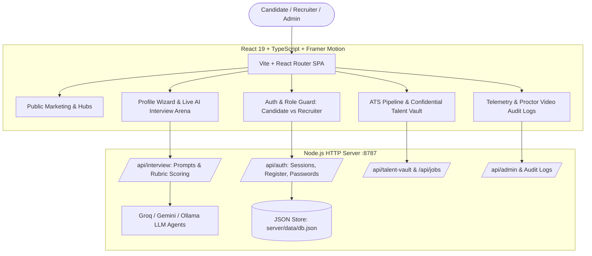
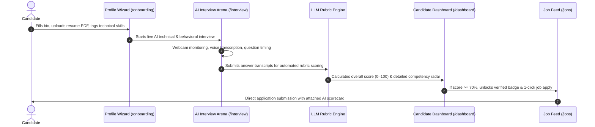
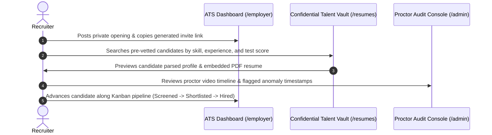

# HireRighttt — System Architecture, Site Map & UI Specification

> **Context for AI Models / ChatGPT**: This document is the single source of truth for **HireRighttt**, an AI-powered autonomous technical recruitment and interview assessment platform. Use this specification to understand the platform's architecture, user flows, routing, component hierarchy, design tokens, and to generate UI visual prompts and mockups.

---

## 1. Executive Overview & Mission
**HireRighttt** is an autonomous AI hiring platform connecting verified technical talent (with an initial focus on African engineering talent) with global technology companies.

- **Candidate Core Value**: Autonomous AI interviews, objective rubric scorecard (0–100), verified skill badges, and direct 1-click matching with verified tech roles.
- **Employer Core Value**: Automated first-round technical screening, confidential pre-vetted talent vault, private invite-only job apply links, and fraud/proctoring audit timeline.
- **Admin Core Value**: System telemetry, LLM latency and token analytics, proctor video audit trail, and evaluation calibration.

---

## 2. Design System & Brand Palette

The platform uses a modern **Shadcn UI** aesthetic: clean geometry, 6px–8px border radii, subtle elevation shadows, crisp contrast, and zero clutter.

| Design Token | Hex Code | Purpose |
| :--- | :--- | :--- |
| **Obsidian Dark** | `#070a12` | Dark landing hero background, high-tech dark surfaces |
| **Slate Navy** | `#0f172a` | Primary text on light mode, dark mode container cards |
| **Electric Blue** | `#2563eb` | Primary brand color, primary CTA buttons, active state |
| **Cyan Glow** | `#38bdf8` / `#60a5fa` | Secondary gradient accent, score highlights, badges |
| **Surface Light** | `#ffffff` / `#f8fafc` | Card backgrounds, inputs, popovers |
| **Border / Divider** | `#e2e8f0` | Standard Shadcn card outlines and dividers |
| **Hover Slate** | `#f1f5f9` | Menu item and list hover background |
| **Success Emerald** | `#10b981` | Score passed (>= 70%), verified talent checks |
| **Destructive Red** | `#ef4444` | Sign out button hover, proctoring violation alerts |

---

## 3. High-Level Technical Architecture

---

## 4. Complete Site Map & Routing Matrix

| Route Path | Page Component | Access Level | Description & Features |
| :--- | :--- | :--- | :--- |
| `/` | `HomePage.tsx` | Public | Hero value prop, live platform stats, African talent spotlight, partner logo ticker. |
| `/how-it-works` | `HowItWorksPage.tsx` | Public | Dual-tab interactive workflow (Candidate journey vs Recruiter journey). |
| `/solutions` | `SolutionsPage.tsx` | Public | Hiring solutions segmented by company tier (Startups, Scaleups, Global remote). |
| `/job-seekers` | `JobSeekersPage.tsx` | Public | Candidate benefits, process breakdown, and interactive Talent Value Calculator. |
| `/why` | `WhyPage.tsx` | Public | Competitive matrix vs legacy ATS systems and Recruiter ROI calculator. |
| `/resources` | `ResourcesPage.tsx` | Public | STAR method answer builder, evaluation rubrics, FAQ searchable hub. |
| `/pricing` | `PricingPage.tsx` | Public | 3-tier subscription grid (Starter, Growth, Enterprise) with feature comparison. |
| `/about` | `AboutPage.tsx` | Public | Company mission, leadership team, SOC-2 and GDPR compliance trust center. |
| `/contact` | `ContactPage.tsx` | Public | Enterprise sales demo requests and user support inquiry form. |
| `/login` | `AuthPages.tsx` | Public | Role-aware authentication with instant 1-click demo credential toggles. |
| `/signup` | `AuthPages.tsx` | Public | Dual registration form (Candidate profile vs Employer company account). |
| `/apply/:code` | `CandidateApplyPage.tsx` | Public / Invite | Private invite link gateway tied to a specific employer opening. |
| `/onboarding` | `ProfileWizard.tsx` | Candidate | 5-step setup wizard: Bio, resume parsing, skill chips, sample test run. |
| `/interview` | `InterviewPage.tsx` | Candidate | Live AI proctored interview arena: camera, mic waveform, dynamic questions, automated scorecard. |
| `/dashboard` | `AppPages.tsx` | Candidate | Candidate hub: Readiness score (0–100), AI strengths radar, unlocked jobs. |
| `/jobs` | `AppPages.tsx` | Candidate | Verified job feed with 1-click apply for candidates meeting score threshold. |
| `/applications` | `AppPages.tsx` | Candidate | Real-time status pipeline of all submitted job applications. |
| `/profile` | `AppPages.tsx` | Candidate | Candidate profile editor, resume skill tags, portfolio, and experience. |
| `/employer` | `EmployerDashboard.tsx` | Recruiter | Candidate pipeline Kanban board, job opening creator, private invite link dispenser. |
| `/resumes` | `ResumeDatabasePage.tsx` | Recruiter | Confidential Talent Vault: Multi-filter candidate search with embedded PDF viewer. |
| `/admin` | `AdminDashboard.tsx` | Admin | System health telemetry, proctor flag inspection, and LLM audit logs. |
| `/settings` | `AuthPages.tsx` | Authenticated | Password, notification preferences, and privacy controls. |

---

## 5. End-to-End User Workflows

### Candidate Journey

### Recruiter Journey

---

## 6. Page-by-Page UI Layout Specs & Image Generation Prompts

### Page 1: Landing Page (`/`)
- **Layout**: Sticky top navigation with brand logo and CTA -> Dark hero section with headline, floating verified scorecard card -> Live metrics banner -> 3-pillar feature grid -> African engineering talent spotlight with profile avatars -> Enterprise logo ticker -> Footer.
- **UI Image Prompt**:
  > Modern SaaS landing page UI for AI hiring platform 'HireRighttt', dark obsidian background `#070a12`, electric blue `#2563eb` and cyan `#38bdf8` soft glowing gradients, central hero header with floating verified scorecard badge, partner logo strip, clean typography, Shadcn UI minimalist aesthetic, 8k resolution, crisp vector layout.

---

### Page 2: Live AI Interview Arena (`/interview`)
- **Layout**: Top bar with interview progress counter and emergency exit button -> Left pane: Live webcam preview with subtle facial recognition boundary, mic audio waveform visualizer, and proctoring status pill -> Right pane: Current interview question card with countdown timer, answer transcript input textarea, voice dictation toggle, and next question button.
- **UI Image Prompt**:
  > High-tech AI video interview web UI, dark slate `#0f172a`, webcam feed panel on left with subtle face detection border, dynamic technical interview question card on right, electric blue audio waveform visualizer, countdown timer badge, clean Shadcn UI buttons, futuristic minimalist workspace.

---

### Page 3: Candidate Dashboard & Scorecard (`/dashboard`)
- **Layout**: User greeting and overall readiness score gauge (e.g., 88/100) -> 4-metric competency breakdown bars (Problem Solving, System Design, Communication, Technical Accuracy) -> AI feedback executive summary quote block -> Unlocked job recommendations grid with match percentages and 1-click apply buttons.
- **UI Image Prompt**:
  > SaaS candidate analytics dashboard UI, dark slate theme, circular readiness score gauge showing 88%, breakdown metric cards with electric blue progress bars, AI recruiter feedback quote block, recommended job cards, Shadcn UI clean typography, high contrast, zero clutter.

---

### Page 4: Recruiter ATS Pipeline & Kanban (`/employer`)
- **Layout**: Header with hiring velocity KPIs and 'Create Opening' modal trigger -> Private application invite link dispenser card -> 4-column drag-and-drop Kanban board (Applied, AI Screened, Shortlisted, Hired) -> Candidate cards showing candidate name, AI interview score pill, role, and actions.
- **UI Image Prompt**:
  > Clean enterprise recruitment pipeline dashboard UI, light slate surface `#f8fafc` with deep navy headings `#0f172a`, 4-column kanban board with candidate cards, electric blue interview score pills, action buttons, clean modal overlay, Shadcn UI design system.

---

### Page 5: Confidential Talent Vault (`/resumes`)
- **Layout**: Left filter drawer (skills multiselect, experience slider, minimum AI score filter) -> Center candidate gallery with profile cards, verified green checkmarks, skill tags, and location pills -> Right modal preview showing embedded PDF resume and AI interview summary.
- **UI Image Prompt**:
  > Enterprise talent search portal UI, filter sidebar on left with skill tags, candidate profile cards with verified checkmarks, score badges in electric blue, right pane embedded PDF resume viewer, clean slate borders `#e2e8f0`, modern minimalist web app.

---

### Page 6: Interactive Resources & STAR Hub (`/resources`)
- **Layout**: Search bar header -> Interactive 4-stage STAR method builder (Situation, Task, Action, Result) with real-time answer strength meter -> Expandable evaluation rubrics accordion -> Categorized technical and behavioral FAQ grid.
- **UI Image Prompt**:
  > Modern educational resource web UI for interview prep, dark navy background with cyan accents, 4-step interactive STAR framework form card, real-time response score strength meter, expandable rubric accordion, Shadcn UI inputs, elegant design.

---

### Page 7: Pricing & Tiers (`/pricing`)
- **Layout**: Monthly/Annual billing switcher -> 3-column card pricing grid (Starter at $99/mo, Growth at $299/mo, Enterprise Custom) -> Center 'Growth' card highlighted with Electric Blue border and glowing badge -> Feature comparison matrix table below.
- **UI Image Prompt**:
  > Modern SaaS pricing page UI with 3 subscription tiers, center growth card highlighted with electric blue border and glowing 'Recommended' badge, emerald checkmark feature lists, annual toggle switch, clean dark mode layout.

---

### Page 8: Profile Onboarding Wizard (`/onboarding`)
- **Layout**: Top 5-step numbered progress bar -> Dynamic center form card (Step 1: Bio & Contact, Step 2: Drag-and-drop PDF resume upload with instant parsing chip, Step 3: Interactive skill tags, Step 4: AI interview equipment check, Step 5: Ready to launch).
- **UI Image Prompt**:
  > Multi-step onboarding wizard UI, step indicator bar at top with 5 stages, central drag-and-drop resume upload zone with dashed border and cloud icon, interactive tag selector chips, clean Shadcn UI buttons, electric blue primary accents.

---

### Page 9: Proctor & Admin Audit Console (`/admin`)
- **Layout**: System health banner (API latency, LLM response time, active interviews) -> Proctoring incident log table with timestamped anomaly tags (Multiple faces detected, Tab switch, Audio silence) -> Video playback scrubber with flagged violation markers.
- **UI Image Prompt**:
  > AI proctoring and telemetry administration dashboard UI, dark obsidian interface, video playback window with timeline anomaly flags in red and yellow, system health metric graphs, data table with user audit logs, clean cyber-forensics theme.

---

## 7. How to Use with ChatGPT / Image Generation Tools
1. **To Generate UI Mockups**: Copy any prompt from Section 6 into Midjourney, DALL-E 3, Flux, or Stable Diffusion.
2. **To Generate Frontend Code**: Prompt ChatGPT with:
   > *"Using the HireRighttt specification from Section 2 (Design Tokens) and Section 6, generate a React 19 + Tailwind/CSS component for [Page Name] adhering to the Shadcn UI design language."*
3. **To Generate Marketing Copy / Pitches**: Reference Section 1 and Section 4 for persona-specific value propositions.
